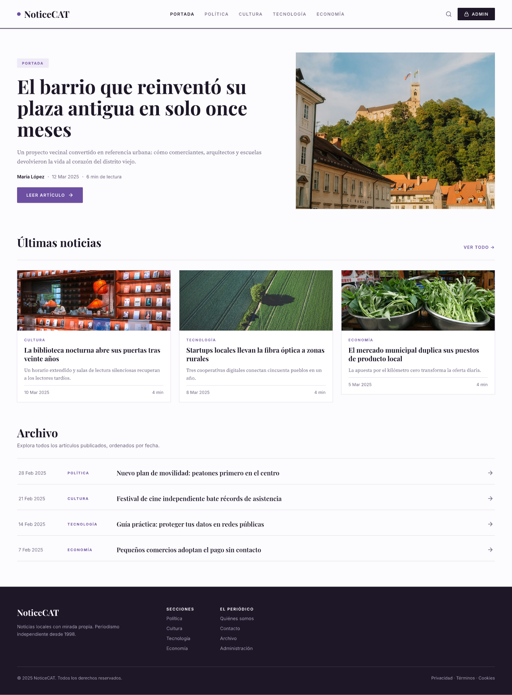
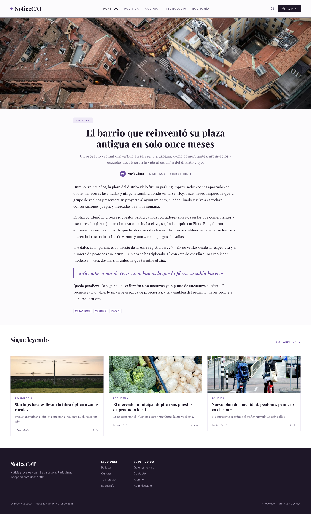
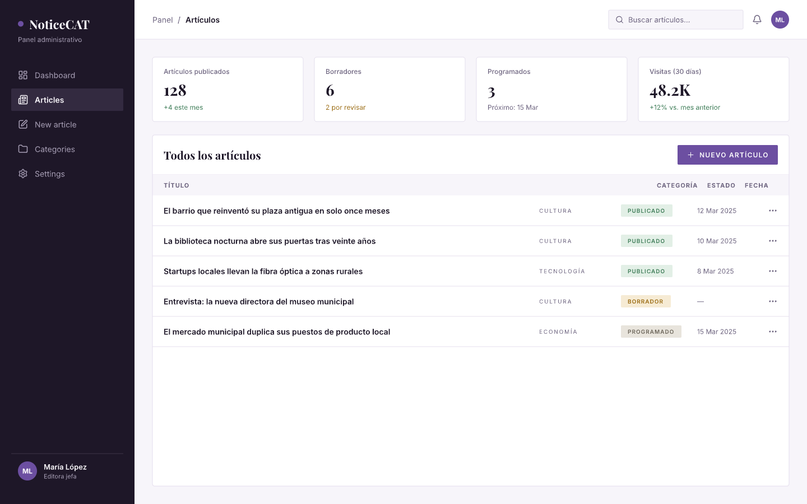
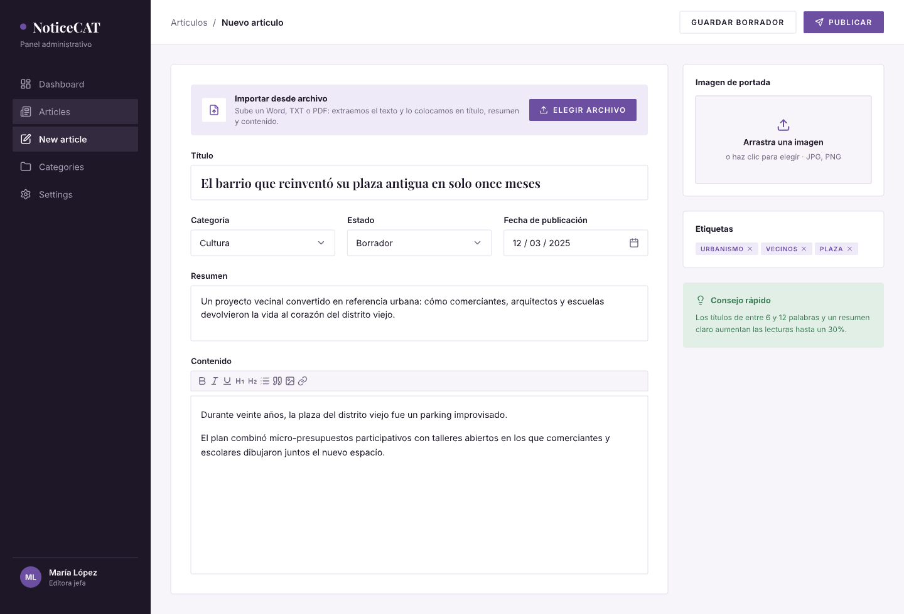
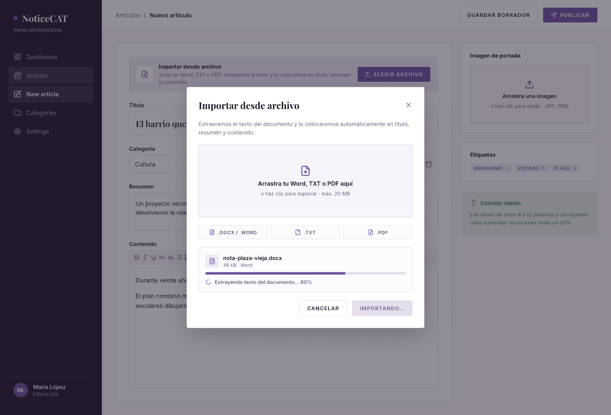
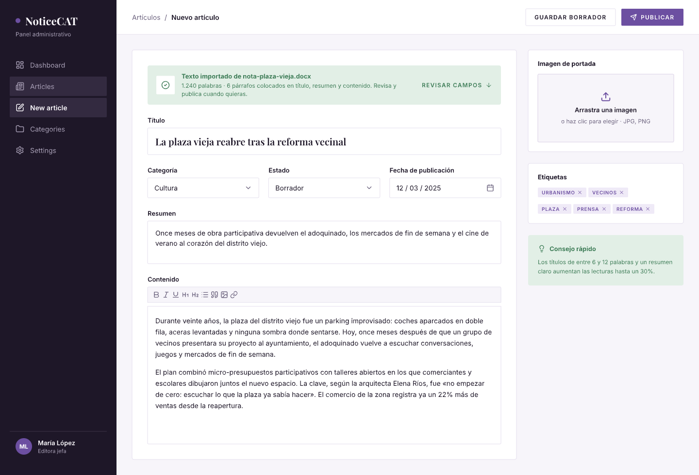

# NoticeCAT 📰

Blog de noticias con panel administrativo, diseñado en [pen.dev](https://pen.dev) y exportado a HTML + Tailwind CSS.

Estética editorial formal en lila pastel: tipografías *Playfair Display* (titulares), *Source Serif 4* (lectura) e *Inter* (interfaz), filetes de periódico y versalitas espaciadas.

## Pantallas

### Público
| Archivo | Descripción |
| --- | --- |
| [`index.html`](./index.html) | Portada: cabecera, hero editorial, últimas noticias, **archivo de artículos pasados** y footer |
| [`articulo.html`](./articulo.html) | Página de artículo: portada a sangre, cuerpo serif, cita destacada, etiquetas y relacionados |

### Panel administrativo
| Archivo | Descripción |
| --- | --- |
| [`admin-dashboard.html`](./admin-dashboard.html) | Dashboard: métricas y tabla de todos los artículos con estado (publicado / borrador / programado) |
| [`admin-editor.html`](./admin-editor.html) | Editor de artículos: título, categoría, estado, fecha, resumen, contenido con barra de herramientas, portada y etiquetas |
| [`admin-subir-archivo.html`](./admin-subir-archivo.html) | Modal de importación: subir **Word / TXT / PDF** con zona de arrastre y progreso de extracción de texto |
| [`admin-texto-importado.html`](./admin-texto-importado.html) | Resultado de la importación: texto extraído colocado automáticamente en título, resumen, contenido y etiquetas |

## Cómo verlo

Abre cualquier `.html` en el navegador (Tailwind se carga por CDN, no requiere build):

```bash
# opción 1: abrir directamente
open index.html

# opción 2: servidor local
python -m http.server 8000
# → http://localhost:8000
```

## Previews

| Portada | Artículo |
| --- | --- |
|  |  |

| Admin · Dashboard | Admin · Editor |
| --- | --- |
|  |  |

| Admin · Subir archivo | Admin · Texto importado |
| --- | --- |
|  |  |

## Funcionalidad destacada

- **Subida de Word / TXT / PDF**: el editor permite importar un documento, extrae su texto y lo reparte automáticamente entre título, resumen, contenido y etiquetas, listo para revisar y publicar.
- **Archivo histórico**: todos los artículos pasados quedan listados por fecha y categoría en la portada.
- **Flujo editorial simple**: borrador → programado → publicado, visible en un solo vistazo desde el dashboard.

---

Diseño y prototipo: pen.dev · Export: HTML + Tailwind CSS
